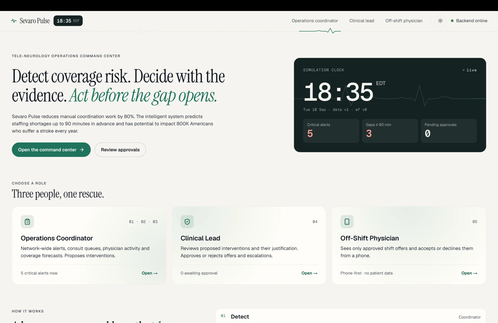
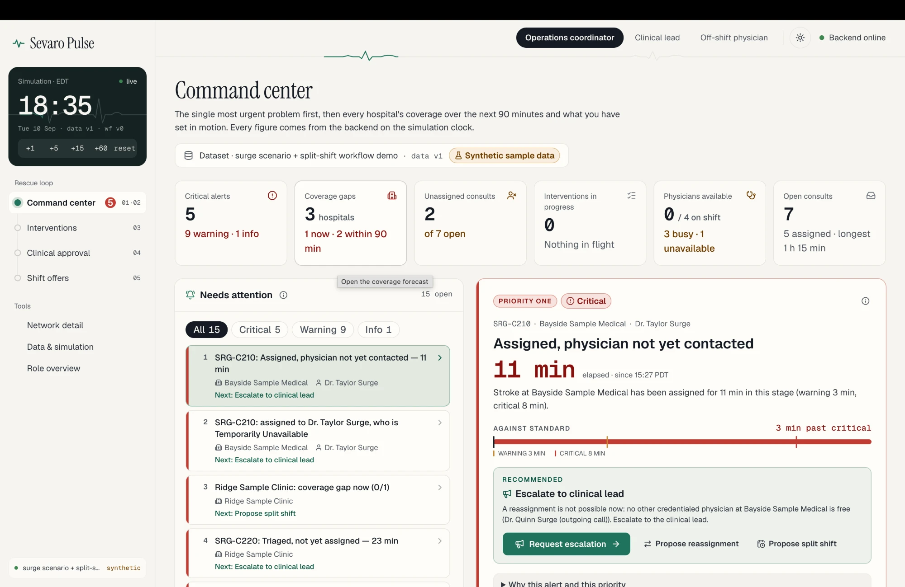

# Sevaro Pulse: Tele-Neurology Operations Command Center

### Video Demo [Link] : https://youtu.be/NKqWVpLLpUA?si=E7BHrb9JixFUqIes

A hackathon build for the Rutgers Health Hack (Sevaro Challenge 2). It **detects**
coverage risk across a tele-neurology network, helps operations **decide** on an
intervention, and **acts** on it through clinical-lead approval and simulated offers to
off-shift physicians.

No patient information is stored or displayed, and no real SMS,
email or hospital integration exists.

## Screenshots





## Repository layout

```
backend/    FastAPI + Pydantic v2 + SQLAlchemy (SQLite)
  app/
    api/routes/      HTTP routes (health, config)
    core/            settings, standard error envelope, time-zone utilities
    schemas/         Pydantic contracts: hospital, physician, consultation, event, alert,
                     coverage, intervention, offer, audit, dataset, system
    db/              engine/session, UTC-enforcing column type, ORM models
    repositories/    DB access only
    services/        orchestration; dataset_import/ interface + placeholder
    engines/         pure logic: event_processing, physician_state, consultation_state,
                     replay, rules, demand, coverage_prediction, alert_detection,
                     analysis, optimization_input, optimization (Phase 4),
                     interventions (Phase 5: state machines, policy, overlay, privacy)
    services/        … + workflow.py (Phase 5 orchestration, transactions, audit)
  data/raw/          drop dataset CSVs / ZIP here (git-ignored)
  sample_data/       SYNTHETIC SAMPLE DATA fixtures: synthetic_dev, synthetic_surge,
                     synthetic_staffing, synthetic_workflow (Phase 5 demo)
  scripts/           fixture generators (deterministic)
  tests/
frontend/   Next.js 16 App Router + TypeScript + Tailwind v4 + shadcn/ui + Lucide + Recharts
  src/app/           /, /coordinator, /clinical-lead, /physician
  src/components/    ui/ (shadcn), layout/ (app shell), landing/, status/, shared/,
                     coordinator/, coverage/, optimization/, workflow/, clinical-lead/,
                     physician/
  src/lib/api/       typed API client + types
deploy/     Caddyfile (one-origin reverse proxy); aws/ CloudFormation stack + deploy.sh;
            helm/ Kubernetes chart (future scope, not deployed)
docker-compose.yml         backend + frontend + Caddy, for local Docker and the AWS host
docs/
  architecture.md          layers, data model, team ownership split
  event-processing.md      replay rules, lifecycle transitions, availability precedence, API
  risk-and-coverage.md     alert rules & thresholds, ranking, demand spikes, coverage forecast
  optimization.md          dispatch (min-cost flow), split shifts (CP-SAT), trap, what-if
  dataset-import-plan.md   ZIP/CSV import: mapping, validation, atomic replacement
  workflow.md              Phase 5: state machine, approvals, offers, conflicts, activation
  voluntary-availability.md  "I'm Available": persistence, ranking preference, cost model
  deployment.md            Docker images, compose stack, AWS (EC2 + ECR via CloudFormation)
```

## Prerequisites

- Python **3.11+** (developed on 3.12)
- Node.js **20.9+** and npm

## Run it

**Backend** (terminal 1):

```bash
cd backend
python3.12 -m venv .venv
source .venv/bin/activate
pip install -r requirements-dev.txt
cp .env.example .env
uvicorn app.main:app --reload --port 8000
```

The API serves at http://localhost:8000. Interactive docs are at http://localhost:8000/docs.

**Frontend** (terminal 2):

```bash
cd frontend
npm install
cp .env.example .env.local
npm run dev
```

Open http://localhost:3000. Use the **Demo role** switcher in the header to move
between Coordinator, Clinical Lead and Physician views. There is no login.

**Or with Docker** (one command, served at http://localhost through Caddy):

```bash
docker compose up --build
```

**Deploy to AWS** (one EC2 host, images in ECR; needs AWS CLI v2, Docker and `jq`):

```bash
deploy/aws/deploy.sh up
```

See [docs/deployment.md](docs/deployment.md) for HTTPS, access restriction, updates,
rollbacks, logs, costs and teardown.

## Checks

```bash
cd backend && .venv/bin/pytest && .venv/bin/ruff check . && .venv/bin/ruff format --check .
cd frontend && npx tsc --noEmit && npm run lint && npm run build
```

## Demo

Voluntary availability (load **workflow sample**; details in
[docs/voluntary-availability.md](docs/voluntary-availability.md)):

1. **Coordinator**: select *Ridge Sample Clinic: coverage gap now*. *Who to ask first*
   ranks Dr. Vale Surge #1 and Dr. Yara Surge #2.
2. **Physician**, signed in as Dr. Yara Surge: **I'm Available** → **Next 4 h** →
   **Share availability**. The phone says she has not been assigned a shift.
3. **Coordinator** (refreshes live): Yara is #1 with **Voluntarily Available** and
   *Up from #2*. Her coverage is within 15% of Vale's, and she has already said yes.
4. **Propose split shift**: Yara is the proposed physician. The drawer shows why she moved
   up and the cost (same $800 as Vale, $400 less than the manual heuristic, all marked
   *Simulated*). Submit for clinical-lead approval and continue as in Phase 5. Withdrawing
   the availability puts Vale back first.
